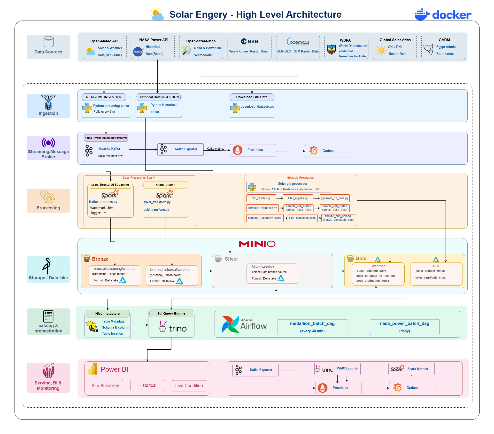

# Solar Data Platform

A Dockerized data engineering platform for turning solar and environmental data into reliable, queryable, and decision-ready insights for Egypt. The platform combines historical NASA POWER observations, near-real-time Open-Meteo weather readings, geospatial site suitability analysis, a Delta Lake medallion architecture, and operational dashboards.

## Contents

- [What this platform does](#what-this-platform-does)

- [Architecture](#architecture)

- [End-to-end data flow](#end-to-end-data-flow)

- [Technology stack](#technology-stack)

- [Repository layout](#repository-layout)

- [Quick start](#quick-start)

- [Running the ingestion pipelines](#running-the-ingestion-pipelines)

- [Medallion data model](#medallion-data-model)

- [GIS suitability pipeline](#gis-suitability-pipeline)

- [Orchestration and schedules](#orchestration-and-schedules)

- [Querying with Trino](#querying-with-trino)

- [Dashboards and observability](#dashboards-and-observability)

- [Configuration](#configuration)

- [Data quality and reliability](#data-quality-and-reliability)

- [Useful commands](#useful-commands)

- [Troubleshooting](#troubleshooting)

- [Security notes](#security-notes)

- [Contributing](#contributing)

## What this platform does

The platform is designed around two complementary data paths:

1. **Historical weather and solar data** — the NASA POWER hourly API is loaded in batches into the historical Bronze layer. The loader is incremental and merges records using deterministic event IDs, making retries and re-runs safe.

1. **Near-real-time weather data** — a poller requests current readings from Open-Meteo for 27 monitored locations, publishes normalized JSON events to Kafka, and Spark Structured Streaming persists those events to the streaming Bronze Delta table.

Both paths converge in the Silver layer, where records are unioned, range-validated, quarantined when invalid, de-duplicated, and enriched with UTC date/hour fields. Gold transformations then produce daily radiation metrics, location-level solar potential rankings, and peak production-hour aggregates.

A parallel GIS workflow downloads and processes raster, vector, and boundary data to screen candidate locations using land-use, water, urban/agricultural distance, terrain, solar-atlas, and administrative-boundary constraints. Processed GIS outputs are staged as Parquet and promoted into Gold Delta tables through Spark.

## Architecture


### Architectural principles

- **One normalized weather schema:** NASA POWER and Open-Meteo records use compatible Bronze columns so they can be unioned downstream.

- **Object-storage lakehouse:** MinIO provides an S3-compatible local data lake; Delta Lake provides transactional tables and schema-aware writes.

- **Separate batch and streaming paths:** historical backfills do not block live weather ingestion.

- **Idempotent processing:** deterministic event IDs, Delta merges, checkpoints, and scoped GIS partition overwrites limit duplication and accidental data loss.

- **Query/compute separation:** Spark writes and transforms data; Hive Metastore and Trino expose registered Delta tables for SQL and BI clients.

- **Operational visibility:** Kafka Exporter, Spark metrics, Trino JMX metrics, Prometheus, and Grafana cover the main runtime components.

## End-to-end data flow

```
NASA POWER API ──► nasa_loader.py ─────────────────────────────► MinIO
                                                                  bronze/historical/weather

Open-Meteo API ──► streaming_poller/poller.py ──► Kafka
                                                     weather.raw
                                                        │
                                                        ▼
                                          Spark Structured Streaming
                                                        │
                                                        ▼
                                                   MinIO / Delta
                                                   bronze/realtime/weather

Bronze (historical + streaming)
                │
                ▼
        silver_transform.py
        - schema alignment
        - range validation
        - quarantine invalid rows
        - de-duplication
        - UTC date/hour derivation
                │
                ▼
             Silver
          silver/weather
                │
                ▼
         gold_transform.py
                │
                ├── gold/solar_radiation_daily
                ├── gold/solar_potential_by_location
                └── gold/peak_production_hours

GIS datasets ──► Python/GeoPandas/Rasterio/H3 workflow ──► Parquet staging
                                                           │
                                                           ▼
                                         Spark GIS promotion jobs ──► Gold GIS Delta tables

Gold Delta tables ──► Hive Metastore ──► Trino ──► Superset / Power BI

Kafka, Spark, and Trino metrics ──► Prometheus ──► Grafana
```

## Technology stack

| Layer | Technologies | Role |
| --- | --- | --- |
| Source data | NASA POWER, Open-Meteo, OpenStreetMap, ESA/Copernicus, WDPA, Global Solar Atlas, GADM | Weather, solar, land-use, protected-area, terrain, and boundary inputs |
| Ingestion | Python, `requests`, `tenacity`, `confluent-kafka` | API extraction, retries, normalization, and Kafka publishing |
| Messaging | Apache Kafka in KRaft mode | Durable event transport for live weather data |
| Processing | Apache Spark 3.5, PySpark, Structured Streaming | Streaming Bronze writes and Silver/Gold transformations |
| Storage | MinIO, Delta Lake, Parquet | S3-compatible object storage, transactional tables, and GIS staging |
| Catalog/query | Hive Metastore, PostgreSQL, Trino | Shared metadata and SQL access to Delta data |
| Orchestration | Apache Airflow, Celery Executor, Redis | Scheduled NASA and medallion workflows |
| GIS | GDAL, GeoPandas, Rasterio, Shapely, H3 | Raster/vector processing and candidate-site suitability analysis |
| BI | Apache Superset, Power BI | Interactive analytics, GIS exploration, and reporting |
| Observability | Prometheus, Grafana, Kafka Exporter, Spark metrics, Trino JMX Exporter | Health and runtime monitoring |
| Runtime | Docker Compose | Reproducible local multi-service environment |

## Repository layout

```
.
├── config/
│   ├── airflow/                  # Local Airflow auth configuration
│   ├── grafana/                  # Datasource and provisioned dashboards
│   ├── prometheus/               # Prometheus scrape configuration
│   ├── spark/                    # Spark metrics configuration
│   ├── superset/                 # Superset configuration and dependencies
│   └── trino/                    # Delta catalog, JVM, and JMX exporter config
├── dashboards/
│   └── Powerbi/                  # Power BI model and Trino query examples
├── docker/
│   ├── gis/                      # GIS processor image
│   └── spark/                    # Shared Spark image
├── docs/
│   ├── architecture/             # High-level architecture diagram
│   ├── docker-compose-guide.md    # Detailed staged Compose guide
│   └── INGESTION_GUIDE.md         # Detailed ingestion and validation guide
├── gis/
│   ├── data/                     # Raw/processed GIS artifacts
│   └── scripts/                  # Download, transform, score, and export jobs
├── kafka/topic_configs/           # Topic definitions and lifecycle status
├── orchestration/airflow/dags/   # NASA and medallion DAGs
├── src/
│   ├── batch/jobs/               # Silver, Gold, catalog, and GIS promotion jobs
│   ├── common/                   # Shared Spark session builder
│   ├── ingestion/                # NASA loader and Open-Meteo poller
│   └── streaming/                # Kafka-to-Bronze Structured Streaming job
├── docker-compose.yml
├── .env.example
└── README.md
```

## Quick start

### Prerequisites

- Docker Desktop with Linux containers, or Docker Engine plus the Docker Compose plugin

- Git

- At least 10 GB of available memory is recommended for the full stack

- An internet connection for container images, Python packages, and source APIs

### 1. Clone and configure

```bash
git clone https://github.com/AbdulrahmanAyman-Data/solar-data-platform.git
cd solar-data-platform
cp .env.example .env
```

Edit `.env` and replace the placeholder credentials. At minimum, set unique values for:

```
MINIO_ROOT_USER=solaradmin
MINIO_ROOT_PASSWORD=replace-with-a-strong-password
POLL_INTERVAL_SECONDS=900
GRAFANA_ADMIN_USER=admin
GRAFANA_ADMIN_PASSWORD=replace-with-a-strong-password
SUPERSET_SECRET_KEY=replace-with-a-long-random-secret
SUPERSET_ADMIN_PASSWORD=replace-with-a-strong-password
MAPBOX_API_KEY=
```

Generate a Superset secret with Python if needed:

```bash
python -c "import secrets; print(secrets.token_urlsafe(48))"
```

Validate the Compose file without printing secret values:

```bash
docker compose config --quiet
```

### 2. Start the platform

For a complete local environment:

```bash
docker compose up -d --build
docker compose ps -a
```

The first startup downloads several large images and builds the Spark, GIS, and streaming-poller images. Initialization services that exit with code `0` are expected to stop after creating buckets or metadata.

For a more controlled first boot, follow the staged instructions in [`docs/docker-compose-guide.md`](docs/docker-compose-guide.md). That guide starts MinIO, Kafka, Spark, Hive Metastore, Trino, Airflow, monitoring, Superset, and GIS in dependency order and includes service-specific checks.

### 3. Create the Kafka topic

The live poller publishes to `weather.raw`. Create it explicitly if it does not already exist:

```bash
docker compose exec solar-kafka \
  /opt/kafka/bin/kafka-topics.sh \
  --bootstrap-server solar-kafka:9092 \
  --create --if-not-exists \
  --topic weather.raw \
  --partitions 9 \
  --replication-factor 1
```

### 4. Start the live ingestion path

```bash
docker compose up -d --build --force-recreate solar-streaming-poller solar-spark-streaming
docker compose logs -f --tail 50 solar-streaming-poller
```

The poller reads the shared location file and requests current Open-Meteo observations. The Spark streaming service consumes the Kafka topic and writes Delta records to `s3a://bronze/realtime/weather` with a checkpoint at `s3a://checkpoints/weather_raw_to_bronze`.

### 5. Load historical NASA POWER data

The NASA loader runs locally or from the Airflow worker. For a local Python environment:

```bash
python -m venv .venv
source .venv/bin/activate       # Windows PowerShell: .venv\Scripts\Activate.ps1
pip install requests pandas pyarrow deltalake tenacity python-dotenv
```

Run a small test into a separate table first:

```bash
export MONITORED_LOCATIONS_FILE=src/ingestion/streaming_poller/config/monitored_locations.json
export HISTORICAL_YEARS=1
export BRONZE_HISTORICAL_URI=s3://bronze/test/weather
python src/ingestion/nasa_loader.py
```

After validating the result, clear the test overrides and load the default five-year window:

```bash
unset HISTORICAL_YEARS BRONZE_HISTORICAL_URI  # PowerShell: Remove-Item Env:HISTORICAL_YEARS, Env:BRONZE_HISTORICAL_URI
python src/ingestion/nasa_loader.py
```

The loader stops seven days before the current date because NASA POWER data is published with a delay. Use `--full-refresh` when an intentional full-window reload is required.

## Running the ingestion pipelines

### Open-Meteo streaming ingestion

`src/ingestion/streaming_poller/poller.py`:

- loads locations from `src/ingestion/streaming_poller/config/monitored_locations.json`;

- requests current radiation, wind, temperature, humidity, and cloud-cover values in UTC;

- emits one normalized JSON event per new observation to Kafka topic `weather.raw`;

- keys Kafka messages by `location_id`;

- skips duplicate observation timestamps within the process lifetime; and

- retries connection failures, timeouts, HTTP 429, and HTTP 5xx responses.

The default poll interval is five minutes. Open-Meteo updates at a lower cadence and the free API tier is rate-limited, so a value such as `900` seconds is a safer default for all 27 locations.

### Kafka to Bronze

`src/streaming/kafka_to_bronze.py` uses Spark Structured Streaming to:

- consume `weather.raw` from `solar-kafka:9092`;

- parse the JSON payload using an explicit schema;

- write append-only Delta data to `s3a://bronze/realtime/weather`; and

- persist recovery state in `s3a://checkpoints/weather_raw_to_bronze`.

The stream is configured with a one-minute trigger and starts from the earliest available Kafka offset when no checkpoint exists.

### NASA POWER batch ingestion

`src/ingestion/nasa_loader.py`:

- requests hourly NASA POWER data in chunks of up to 365 days;

- maps NASA variables into the shared weather schema;

- converts NASA's `-999` missing-value marker to null;

- generates deterministic UUID5 event IDs from source, location, and observation hour;

- merges into `s3://bronze/historical/weather` on `event_id`; and

- reads the latest stored observation per location to fetch only new data on later runs.

## Medallion data model

### Bronze

Bronze preserves source-shaped, normalized records with transport and ingestion metadata.

| Table/path | Source | Write mode |
| --- | --- | --- |
| `s3://bronze/realtime/weather` | Open-Meteo via Kafka/Spark | Append-only streaming Delta |
| `s3://bronze/historical/weather` | NASA POWER | Incremental Delta merge |

Core columns include `event_id`, `source`, `location_id`, `site_name`, coordinates, `observation_timestamp`, `ghi_w_m2`, `dni_w_m2`, `dhi_w_m2`, `wind_speed_ms`, `temperature_c`, `humidity_pct`, `cloud_cover_pct`, and ingestion metadata.

`location_id` is a **string** such as `cairo`, `aswan`, or `south-sinai`.

### Silver

`src/batch/jobs/silver_transform.py` reads every available Bronze source and writes `s3://silver/weather`.

The Silver job:

1. unions the historical and streaming sources by name;

1. validates coordinate, weather, irradiance, humidity, and cloud-cover ranges;

1. appends invalid rows to `s3://silver/quarantine/weather`;

1. de-duplicates by `source`, `location_id`, and `observation_timestamp`, retaining the latest ingestion;

1. derives `observation_date` and `observation_hour` in UTC; and

1. drops Kafka transport metadata from the curated Silver schema.

### Gold

`src/batch/jobs/gold_transform.py` produces three weather analytics tables:

| Gold table | Purpose |
| --- | --- |
| `s3://gold/solar_radiation_daily` | Daily average/max irradiance, temperature, humidity, cloud cover, and observation counts |
| `s3://gold/solar_potential_by_location` | Location-level solar metrics and rank within each source |
| `s3://gold/peak_production_hours` | Open-Meteo hourly aggregates ranked by likely production hour per location |

The governorate reference jobs build `s3://gold/dim_governorate` and can add WKT/GeoJSON geometry from the processed boundary file.

## GIS suitability pipeline

The GIS workflow lives under [`gis/scripts`](gis/scripts). It is intended to screen Egypt for potential solar sites by combining spatial constraints and solar-resource metrics.

Typical stages include:

1. download source datasets;

1. extract and repair governorate boundaries;

1. clip rasters to the area of interest;

1. generate/sample H3 cells and Solar Atlas statistics;

1. calculate distances to water, urban areas, and agriculture;

1. compute suitability scores and filter eligible cells;

1. export candidate-site polygons and Parquet staging files; and

1. promote eligible zones and candidate sites to Gold Delta tables with Spark.

GIS output is deliberately split into two concepts:

- **Eligible zones:** the full per-cell screening layer after spatial constraints.

- **Candidate sites:** the smaller buildable-unit shortlist after area and distance cutoffs.

The GIS container is available through Jupyter at [http://localhost:8889](http://localhost:8889) after starting `solar-gis-processor`. Delta writes remain centralized in the Spark promotion jobs `gis_zones_to_gold.py` and `gis_candidate_sites_to_gold.py`.

## Orchestration and schedules

Airflow DAGs are in [`orchestration/airflow/dags`](orchestration/airflow/dags):

| DAG | Schedule | Main work |
| --- | --- | --- |
| `nasa_power_batch_dag` | Daily at 03:00 UTC | Incremental NASA POWER load into historical Bronze |
| `solar_medallion_batch` | Every 30 minutes | Silver transform followed by Gold transform |

Both DAGs submit work through the long-lived `solar-spark-submit-client` container. The Airflow worker uses the Docker CLI and mounted Docker socket to invoke the Spark jobs while keeping the Spark/Delta runtime in the submit client.

Airflow is available at [http://localhost:8083](http://localhost:8083). The local development account is configured by the Compose file and `config/airflow/simple_auth_manager_passwords.json`; do not reuse these development credentials in production.

## Querying with Trino

Trino is available at [http://localhost:8085](http://localhost:8085). Tables are registered in the `solar` schema by [`src/batch/jobs/register_tables.py`](src/batch/jobs/register_tables.py) after the corresponding Delta paths exist.

Open a Trino CLI session inside the container:

```bash
docker compose exec -it solar-trino trino --catalog delta --schema solar
```

Example queries:

```sql
SHOW TABLES;

SELECT source,
       count(DISTINCT location_id) AS locations,
       count(*) AS observations
FROM delta.solar.silver_weather
GROUP BY source;

SELECT location_id,
       site_name,
       source,
       avg_ghi_w_m2,
       solar_potential_rank
FROM delta.solar.gold_solar_potential_by_location
WHERE source = 'open-meteo'
ORDER BY solar_potential_rank
LIMIT 10;
```

More validation and BI queries are available in [`dashboards/Powerbi/trino_queries.sql`](dashboards/Powerbi/trino_queries.sql).

## Dashboards and observability

| Interface | URL | Purpose |
| --- | --- | --- |
| MinIO Console | [http://localhost:9001](http://localhost:9001) | Inspect Bronze, Silver, Gold, checkpoint, warehouse, and GIS-staging buckets |
| Kafka UI | [http://localhost:8084](http://localhost:8084) | Browse topics and inspect `weather.raw` messages |
| Spark Master UI | [http://localhost:8081](http://localhost:8081) | Inspect applications and workers |
| Spark Worker UI | [http://localhost:8082](http://localhost:8082) | Inspect worker resources |
| JupyterLab | [http://localhost:8888](http://localhost:8888) | Interactive Spark exploration |
| GIS JupyterLab | [http://localhost:8889](http://localhost:8889) | Interactive GIS processing |
| Airflow | [http://localhost:8083](http://localhost:8083) | Monitor and trigger DAGs |
| Trino | [http://localhost:8085](http://localhost:8085) | Query service and REST/UI endpoint |
| Grafana | [http://localhost:3000](http://localhost:3000) | Platform health and runtime dashboards |
| Prometheus | [http://localhost:9090](http://localhost:9090) | Metrics, targets, and PromQL |
| Superset | [http://localhost:8088](http://localhost:8088) | BI and geospatial dashboards |

Metrics are collected through Kafka Exporter, Spark Prometheus metrics, and the Trino JMX Prometheus agent. Prometheus configuration is in [`config/prometheus/prometheus.yml`](config/prometheus/prometheus.yml), while Grafana provisioning is under [`config/grafana`](config/grafana).

For Superset and Trino startup, the helper script can initialize the Superset metadata database and start both services:

```bash
bash scripts/start_superset_trino.sh
```

The Power BI artifact and query examples are under [`dashboards/Powerbi`](dashboards/Powerbi). The `.pbix` file is a binary dashboard artifact and may require Power BI Desktop for local editing.

## Configuration

The main configuration points are:

| File | Purpose |
| --- | --- |
| `.env` | Local credentials and runtime overrides; never commit it |
| `.env.example` | Safe template for local configuration |
| `config/monitored_locations.json` | Canonical list of the 27 monitored Egyptian locations |
| `src/ingestion/streaming_poller/config/monitored_locations.json` | Container-mounted copy used by the streaming poller |
| `kafka/topic_configs/topics.yaml` | Topic definitions, partitions, retention, and ownership |
| `docker-compose.yml` | Services, dependencies, ports, volumes, and network |
| `config/trino/catalog/delta.properties` | Trino Delta catalog configuration |
| `config/superset/superset_config.py` | Superset runtime settings |

When adding or changing a monitored location, update the canonical location configuration and restart the poller. Re-run the historical loader so the new location receives its historical window.

## Data quality and reliability

The pipeline includes several safeguards:

- deterministic event IDs prevent duplicate historical rows during retries;

- NASA loads are incremental per location and support `--full-refresh` repair runs;

- Open-Meteo polling skips repeated observation timestamps;

- Kafka messages are keyed by location for stable partitioning;

- Spark checkpoints allow the Kafka-to-Bronze stream to recover;

- Silver range checks separate invalid rows into a quarantine Delta table;

- Silver de-duplicates by source, location, and observation timestamp;

- Gold jobs overwrite their derived tables from curated Silver data; and

- GIS promotion jobs use `replaceWhere` to overwrite only the selected governorate partition.

For production use, replace the development credentials, pin mutable container image tags, use TLS and authenticated Kafka/MinIO connections, and avoid exposing the Docker socket to Airflow without a dedicated security review.

## Useful commands

```bash
# Validate configuration
docker compose config --quiet

# Inspect service state
docker compose ps -a

# Follow logs
docker compose logs -f --tail 100 solar-streaming-poller
docker compose logs -f --tail 100 solar-spark-streaming

# Restart a changed service
docker compose up -d --build --force-recreate solar-streaming-poller

# Stop containers but preserve named volumes
docker compose down

# Destructive reset: removes all named volumes and lake/database state
docker compose down -v

# Inspect Kafka messages
docker compose exec solar-kafka \
  /opt/kafka/bin/kafka-console-consumer.sh \
  --bootstrap-server solar-kafka:9092 \
  --topic weather.raw --from-beginning --max-messages 3

# Run the detailed Compose guide from the repository
# See docs/docker-compose-guide.md
```

## Troubleshooting

| Symptom | Likely cause | Action |
| --- | --- | --- |
| MinIO returns `InvalidAccessKeyId` or `SignatureDoesNotMatch` | Credentials changed after the MinIO volume was initialized | Stop the stack, run `docker compose down -v`, update `.env`, and start again; this deletes local data |
| `NoSuchBucket` | Bucket initialization did not complete | Run `docker compose up solar-minio-init` |
| Poller cannot reach Kafka | The poller is using a host address from inside Docker | Use `solar-kafka:9092` inside Compose, not `localhost:9092` |
| No Kafka messages | Topic or poller is not running | Create `weather.raw`, then inspect poller logs and Kafka UI |
| Spark streaming does not write Bronze data | Kafka is unavailable, packages are still downloading, or a checkpoint is inconsistent | Inspect `solar-spark-streaming` logs and confirm MinIO/Kafka health |
| NASA request returns HTTP 422 | A requested NASA parameter is unsupported | Check `PARAM_MAP` in `nasa_loader.py` and remove the unsupported variable |
| `KeyError` for MinIO credentials | The local shell did not load `.env` | Export the variables or use a dotenv-aware shell/Python environment |
| Airflow shows no DAGs | Airflow initialization or DAG processor is not ready | Check `solar-airflow-init`, `solar-airflow-dag-processor`, and mounted DAG paths |
| A Silver run reports no Bronze source | Ingestion has not produced a Delta table yet | Start the streaming path or run the NASA loader first |
| Power BI cannot query tables | Delta tables are not registered or Trino is unavailable | Run `register_tables.py`, then check Trino at port 8085 |

For ingestion-specific details, see [`docs/INGESTION_GUIDE.md`](docs/INGESTION_GUIDE.md). For the complete service-by-service startup sequence, see [`docs/docker-compose-guide.md`](docs/docker-compose-guide.md).

## Contributing

1. Create a focused branch from `main`.

1. Keep secrets, local volumes, virtual environments, and generated credentials out of Git.

1. Update the relevant source documentation when changing a path, schema, topic, schedule, or service.

1. Run at least `docker compose config --quiet` and the relevant smoke checks before opening a pull request.

1. Include data-quality or operational implications in the pull request description.
